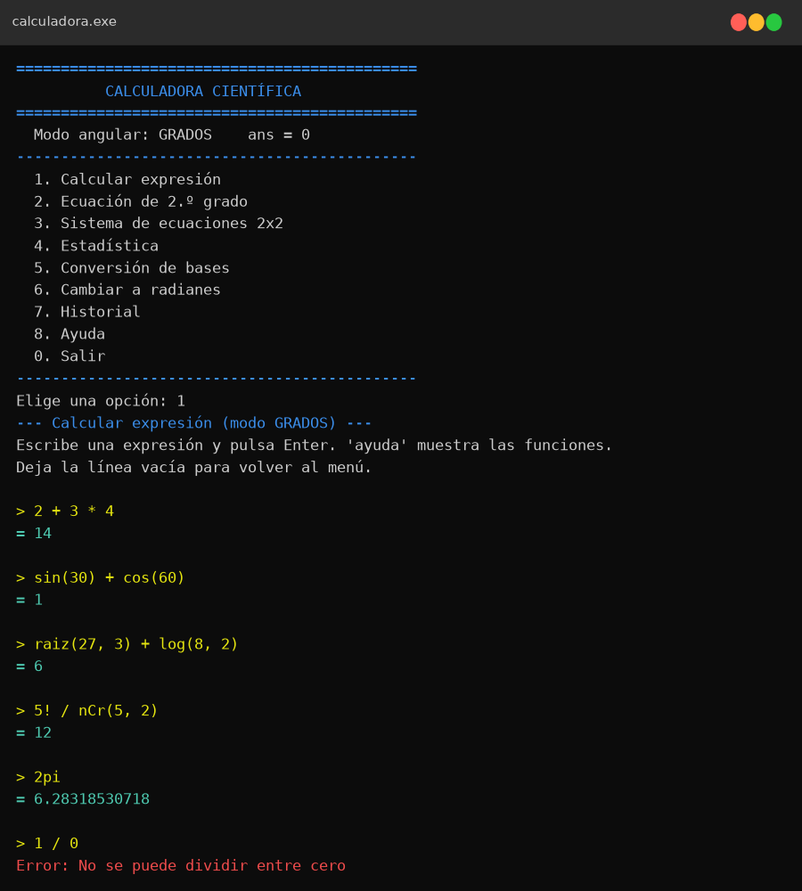
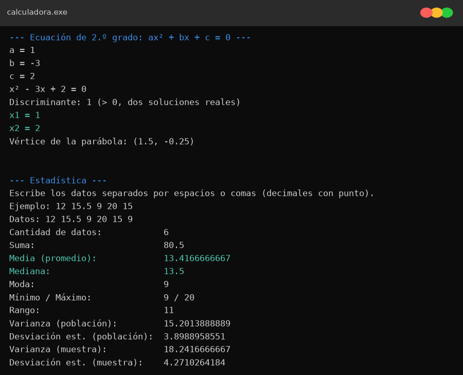

# 🧮 Calculadora Científica en C++

Calculadora científica de consola escrita en **C++17**, sin librerías externas. Evalúa expresiones completas como `2*sin(30) + raiz(27, 3)^2`, resuelve ecuaciones, calcula estadísticas y convierte entre bases numéricas.

| Expresiones | Ecuaciones y estadística |
|---|---|
|  |  |

## ✨ Funciones

**1. Calcular expresiones**, respetando la precedencia de operadores y los paréntesis:
- Operadores: `+  -  *  /  ^` (potencia), `%` (residuo) y `!` (factorial).
- Trigonometría en **grados o radianes**: `sin` (o `sen`), `cos`, `tan`, `asin`, `acos`, `atan`.
- Hiperbólicas: `sinh`, `cosh`, `tanh`.
- Raíces y logaritmos: `sqrt`/`raiz`, `raiz(x, n)` (raíz n-ésima), `cbrt`, `ln`, `log`, `log(x, base)`, `exp`.
- Otras: `abs`, `floor`, `ceil`, `round`, `fact`, `nCr` (combinaciones), `nPr` (permutaciones).
- Constantes `pi` y `e`, y **`ans`** para usar el último resultado.
- Multiplicación implícita: `2pi`, `3(4 + 1)`, `(1 + 2)(3 + 4)`.

**2. Ecuación de 2.º grado** `ax² + bx + c = 0`: soluciones reales o complejas (`-1 ± 2i`), discriminante y vértice de la parábola. Usa una fórmula estable que no pierde precisión.

**3. Sistemas de ecuaciones 2x2** por la regla de Cramer. Indica si el sistema no tiene solución (rectas paralelas) o tiene infinitas (la misma recta).

**4. Estadística**: media, mediana, moda (o modas), mínimo, máximo, rango, y varianza y desviación estándar poblacional y muestral.

**5. Conversión de bases**: decimal, binario, octal y hexadecimal, con algoritmos propios (divisiones sucesivas y método de Horner).

**Además:** historial de operaciones y mensajes de error claros, como `No se puede dividir entre cero`, `La raíz par de un número negativo no es un número real` o `Falta cerrar el paréntesis abierto en la posición 1`. En los menús de números también se pueden escribir expresiones (`a = sqrt(2)`).

## 🚀 Cómo compilar y ejecutar

**Requisitos:** un compilador de C++17, por ejemplo g++ (MinGW, el que trae Dev-C++, o el de Linux/Mac).

**Windows:** doble clic en `compilar.bat`. Compila el programa en `bin\calculadora.exe` y lo abre. Si no tienes g++ en el PATH, busca el que trae Dev-C++.

**Con g++ desde la terminal:**
```bash
g++ -std=c++17 -Wall -O2 src/*.cpp -o calculadora
./calculadora
```

**Con make:**
```bash
make            # compila bin/calculadora
make pruebas    # compila y ejecuta las pruebas
```

## ✅ Pruebas

`tests/pruebas.cpp` tiene **108 pruebas automáticas**: precedencia de operadores, trigonometría en grados y radianes, logaritmos, factorial, combinatoria, estadística, ecuaciones, sistemas, bases y todos los casos de error.

```bash
compilar.bat pruebas      # Windows
make pruebas              # Linux / Mac / MinGW
```
```
Pruebas aprobadas: 108
Pruebas fallidas:  0
```

## 🧠 Cómo funciona por dentro

El evaluador de expresiones (`src/evaluador.cpp`) trabaja en dos pasos:

1. **Análisis léxico:** separa el texto en *tokens* (números, nombres, operadores y paréntesis). `2*sin(30)` se convierte en `2`, `*`, `sin`, `(`, `30`, `)`.
2. **Análisis sintáctico por descenso recursivo:** cada nivel de precedencia es una función que llama a la del nivel siguiente:

```
expresion := termino (('+' | '-') termino)*
termino   := unario (('*' | '/' | '%') unario)*
unario    := ('-' | '+') unario | potencia
potencia  := postfijo ('^' unario)?        ← asociativa por la derecha: 2^3^2 = 2^9
postfijo  := primario '!'*
primario  := número | constante | función(argumentos) | '(' expresion ')'
```

Así, `2 + 3 * 4` da 14 y no 20, y `-2^2` da -4, como en matemáticas.

## 📂 Estructura

```
calculadora-cientifica/
├── src/
│   ├── main.cpp          # menú y comunicación con el usuario
│   ├── evaluador.h/.cpp  # expresiones y funciones matemáticas
│   ├── estadistica.h/.cpp
│   └── algebra.h/.cpp    # ecuaciones, sistemas y bases
├── tests/pruebas.cpp     # 108 pruebas automáticas
├── compilar.bat          # compilar con doble clic (Windows)
└── Makefile
```

**Estilo del código:** todas las estructuras de control (`if`, `else`, `for`, `while`) llevan llaves `{ }`, aunque tengan una sola línea, para evitar errores al agregar código después.

## 👤 Autor

**Danny Yair Luque Pari**, estudiante de Ingeniería en Informática y Sistemas (UNJBG, Tacna).
[Portafolio](https://mecro-yair.github.io/MI-portafolio/) · [LinkedIn](https://www.linkedin.com/in/danny-yair-luque-pari-548160356/) · [GitHub](https://github.com/Mecro-yair)
